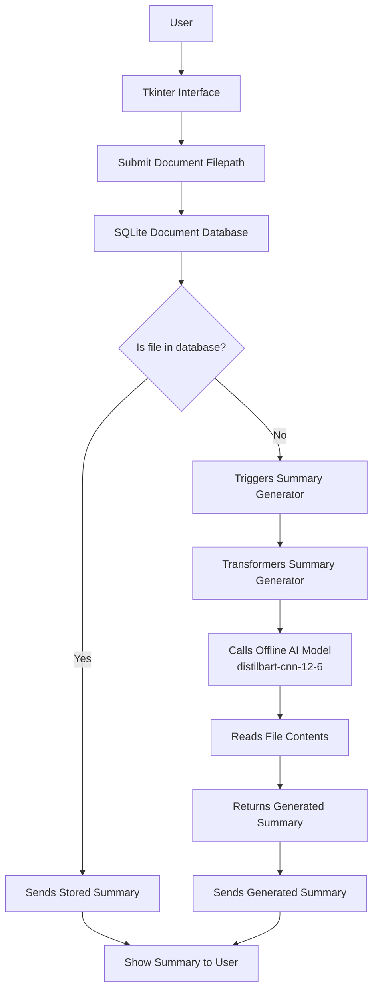

# OfflineDocSummarizer

A standalone app that leverages a trained AI model to summarize your documents entirely offline. 
Features a built-in database for caching summaries, enabling faster access. 
Supports .docx, .pdf, and .txt formats.

## Features
- **Offline AI Summarization** - Downloaded model works completely offline
- **Database caching** - Previously summarized files are retrieved instantly
- **Duplicate checking** - Summaries remain accessible even if files are moved or renamed


## Flow Diagram




## Tech Stack
- **Python tkinter** - For creating the app interface
- **Python hashlib** - For hashing file content, suitable for duplicate checks
- **Python transformers** - For interacting with the `sshleifer/distilbart-cnn-12-6` AI model
- **SQLite** - For document storage and caching


## Installation

### Prerequisites
- **Python 3.12.3+**

### Setup
- **Clone the repository**
    ```bash
    git clone https://github.com/EnacheAdrian05/OfflineDocSummarizer.git
    cd OfflineDocSummarizer
    ```
- **Run the app**
    ```bash
    python app\app.py
    ```
- **Note: the first run will take longer, since the model has to be downloaded. This will no longer be an issue starting from the second run.**
